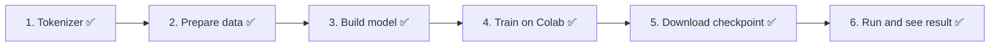
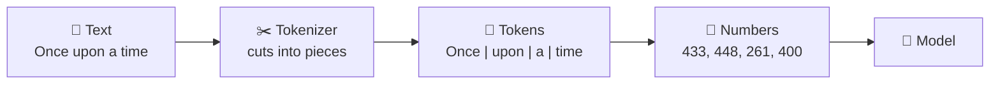
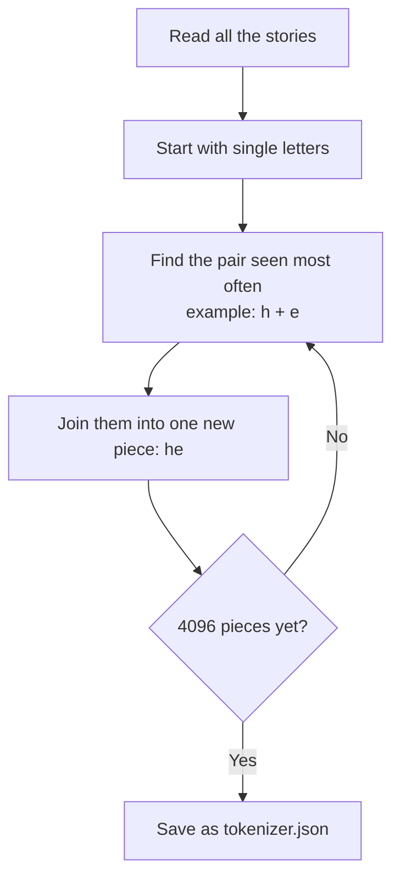
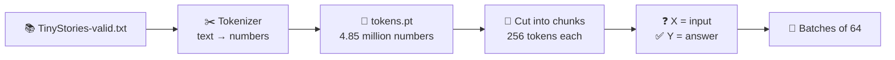
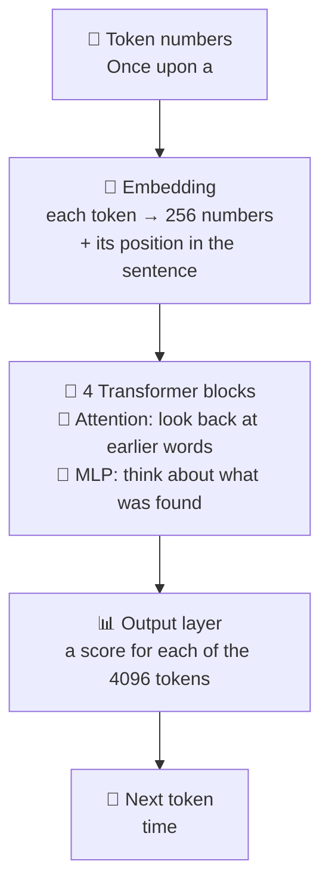
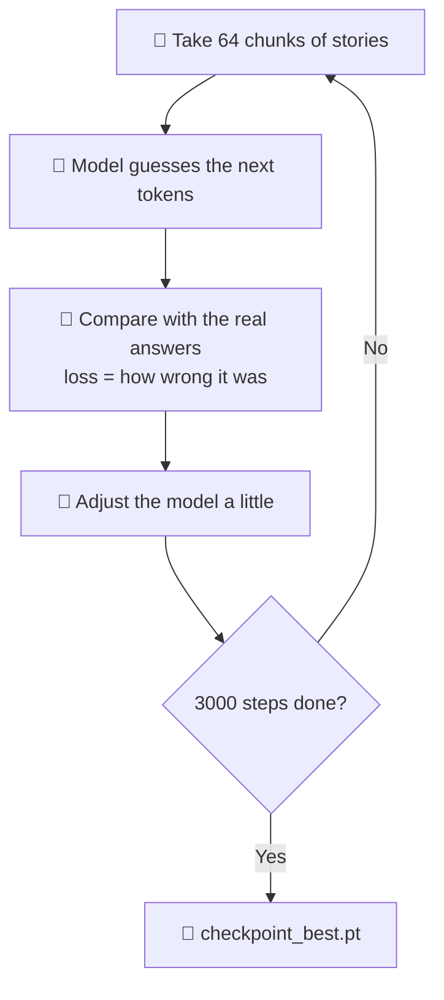
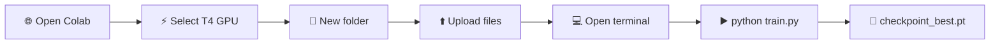
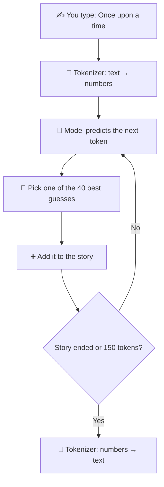

## Introduction

In this project, we build a small language model (LLM) from scratch on a local computer.

"From scratch" means we don't start from a ready-made model. We build every part ourselves: the tokenizer, the model, and the training.

The model learns from TinyStories, a dataset of simple children's stories. The goal is for it to write short stories of its own.

Every step is written down here so anyone can follow along.

## Tech Stack

| Part | What we use | What it's for |
|---|---|---|
| Code editor | Google Antigravity | Writing and running the code (AI-assisted editor) |
| Language | Python 3.11 | All the project code |
| Environment | Python virtual environment (`venv`) | Keeps this project's libraries separate |
| Model library | PyTorch (`torch`) | Building and training the model |
| Tokenizer library | Hugging Face `tokenizers` | Training the tokenizer |
| Serving | FastAPI + uvicorn | Running the finished model as an API (later) |
| Dataset | TinyStories | The text the model learns from |
| Local machine | Windows PC (CPU) | Setup, data and tokenizer |
| Training | Google Colab (T4 GPU) | Training the model, which is much faster on a GPU |

---

# Part A: Setup

### Step 1: Open the code editor
1. Open **Google Antigravity**.
2. Create a new folder called `mini-llm-training`.
3. Open it in Antigravity: **File → Open Folder** → select `mini-llm-training`.
4. Open a terminal: **Terminal → New Terminal**.

### Step 2: Set up Python
In the terminal, create a virtual environment, turn it on, and install the libraries:
```powershell
python -m venv venv
.\venv\Scripts\Activate.ps1
pip install torch tokenizers fastapi uvicorn
```
When `(venv)` appears at the start of the terminal line, the environment is on.

### Step 3: Download the input text file
Download **TinyStories-valid.txt** (19 MB, about 22,000 short stories) into the `mini-llm-training` folder:
```powershell
curl.exe -L -o TinyStories-valid.txt https://huggingface.co/datasets/roneneldan/TinyStories/resolve/main/TinyStories-valid.txt
```
Or download it from the browser: https://huggingface.co/datasets/roneneldan/TinyStories

---

# Part B: Build the LLM

We build the LLM in 6 steps:



## Step 1: Create the tokenizer (`train_tokenizer.py`)

### Why do we need it?
A computer can't read words. It only understands **numbers**.
The **tokenizer** is the translator between the two: it cuts text into small pieces (**tokens**) and gives each piece a number.



> [!tip] Think of it like LEGO
> Common words like "time" are one big brick. Rare words are built from small bricks, for example "Unknown" = `U` + `n` + `known`. So any word can be built.

### How does the tokenizer learn its pieces?
It uses a method called **BPE (Byte-Pair Encoding)**, the same idea GPT models use:



### Technical details
| Setting | Value | Meaning |
|---|---|---|
| Type | Byte-level BPE | Works on raw bytes, so it can handle any text, even emoji 🚀 |
| Vocabulary size | 4096 | The tokenizer knows 4096 pieces |
| `<\|endoftext\|>` | Special token | Marks the end of a story |
| `<\|pad\|>` | Special token | Filler, used to make inputs the same length |
| `<\|unk\|>` | Special token | "Unknown", a backup that is almost never needed |
| Output | `tokenizer.json` | The saved tokenizer, used in all later steps |

### The code
Create a file called `train_tokenizer.py` in the project folder and paste this in:

> [!example]- Click to open: train_tokenizer.py
> ```python
> import os
> from tokenizers import Tokenizer
> from tokenizers.models import BPE
> from tokenizers.trainers import BpeTrainer
> from tokenizers.pre_tokenizers import ByteLevel
> from tokenizers.decoders import ByteLevel as ByteLevelDecoder
>
>
> def main():
>     input_file = "TinyStories-valid.txt"
>     output_file = "tokenizer.json"
>     vocab_size = 4096
>     special_tokens = ["<|endoftext|>", "<|pad|>", "<|unk|>"]
>
>     if not os.path.exists(input_file):
>         raise FileNotFoundError(f"Input file '{input_file}' not found.")
>
>     print(f"Initializing Byte-Level BPE tokenizer...")
>     # Initialize tokenizer with BPE model
>     tokenizer = Tokenizer(BPE(unk_token="<|unk|>"))
>
>     # Use ByteLevel pre-tokenizer and decoder
>     tokenizer.pre_tokenizer = ByteLevel(add_prefix_space=False)
>     tokenizer.decoder = ByteLevelDecoder()
>
>     # Trainer configuration
>     trainer = BpeTrainer(
>         vocab_size=vocab_size,
>         special_tokens=special_tokens,
>         initial_alphabet=ByteLevel.alphabet(),
>         show_progress=True,
>     )
>
>     print(f"Training tokenizer on {input_file} (target vocab_size={vocab_size})...")
>     tokenizer.train([input_file], trainer)
>
>     # Save tokenizer
>     tokenizer.save(output_file)
>     print(f"Tokenizer successfully trained and saved to '{output_file}'.")
>     print(f"Final vocabulary size: {tokenizer.get_vocab_size()}")
>
>     # --- Quick Encode / Decode Test ---
>     test_text = (
>         'Once upon a time, Spot found a shiny toy! <|endoftext|>\n'
>         'Unknown char test: 🚀 1234.'
>     )
>     print("\n--- Test Encode / Decode ---")
>     print(f"Original Text:\n{test_text}\n")
>
>     encoded = tokenizer.encode(test_text)
>     print(f"Token IDs: {encoded.ids}")
>     print(f"Tokens: {encoded.tokens}")
>
>     decoded = tokenizer.decode(encoded.ids, skip_special_tokens=False)
>     print(f"\nDecoded Text (skip_special_tokens=False):\n{decoded}")
>
>     assert test_text == decoded, "Decoded text does not match original text!"
>     print("\nVerification Passed: Decoded text matches the original text perfectly!")
>
>
> if __name__ == "__main__":
>     main()
> ```

### Run it
```powershell
python train_tokenizer.py
```

### Result
It takes a few seconds. At the end you will see:
```
Tokenizer successfully trained and saved to 'tokenizer.json'.
Final vocabulary size: 4096
Verification Passed: Decoded text matches the original text perfectly!
```
A new file, `tokenizer.json`, now appears in the folder.

Example of what the tokenizer does:
```
Text:    Once upon a time, there was a little girl named Lily.
Tokens:  Once | upon | a | time | , | there | was | a | little | girl | named | Lily | .
Numbers: 433, 448, 261, 400, 14, 403, 282, 261, 402, 452, 497, 369, 16
```

---

## Step 2: Prepare the data (`dataset.py`)

### Why do we need it?
The model learns by playing one game over and over: **guess the next word**.
To play, it needs practice questions with answers:
- **X (input):** a piece of a story
- **Y (answer):** the same piece, moved **one token ahead**

This step turns all the stories into numbers and cuts them into these X → Y practice pairs.



> [!tip] Think of it like a fill-in-the-blank quiz
> Cover the next word, guess it, then check the answer:
>
> | Model sees | Must guess |
> |---|---|
> | he | got |
> | he got | to |
> | he got to | eat |
> | he got to eat | his |
>
> One chunk of 256 tokens gives the model 256 of these little quizzes at once.

### Technical details
| Setting | Value | Meaning |
|---|---|---|
| Total tokens | 4,853,545 | The whole dataset, turned into numbers |
| Cache file | `tokens.pt` (39 MB) | The numbers are saved once, so the text is not tokenized again every run |
| `block_size` | 256 | Each chunk is 256 tokens: how much text the model sees at once |
| Sequences | 18,959 | Number of 256-token chunks in the dataset |
| `batch_size` | 64 | The model practices on 64 chunks at the same time |
| `split_ratio` | 0.9 | 90% of tokens for training, 10% kept aside to check the model on text it hasn't seen |
| `shuffle` | True | Mixes the chunks so the model doesn't learn their order |

### The code
Create a file called `dataset.py` in the project folder and paste this in:

> [!example]- Click to open: dataset.py
> ```python
> import os
> import torch
> from torch.utils.data import Dataset, DataLoader
> from tokenizers import Tokenizer
>
>
> class TinyStoriesDataset(Dataset):
>     """
>     Autoregressive Language Modeling Dataset for TinyStories.
>     Prepares input (X) and target (Y) tensor pairs shifted by 1 token.
>     """
>     def __init__(self, txt_path="TinyStories-valid.txt", tokenizer_path="tokenizer.json", block_size=256, cache_path="tokens.pt", split="all", split_ratio=0.9):
>         self.block_size = block_size
>         self.tokenizer = Tokenizer.from_file(tokenizer_path)
>
>         # Check for cached pre-tokenized tensor to save startup time
>         if os.path.exists(cache_path):
>             all_tokens = torch.load(cache_path, weights_only=True)
>         else:
>             if not os.path.exists(txt_path):
>                 raise FileNotFoundError(f"Source text file '{txt_path}' not found.")
>             print(f"Reading and tokenizing '{txt_path}'...")
>             with open(txt_path, "r", encoding="utf-8") as f:
>                 text = f.read()
>
>             encoded = self.tokenizer.encode(text)
>             all_tokens = torch.tensor(encoded.ids, dtype=torch.long)
>             print(f"Saving pre-tokenized tokens ({len(all_tokens):,} tokens) to '{cache_path}'...")
>             torch.save(all_tokens, cache_path)
>
>         # Handle train/val splitting
>         n_train = int(len(all_tokens) * split_ratio)
>         if split == "train":
>             self.tokens = all_tokens[:n_train]
>         elif split == "val":
>             self.tokens = all_tokens[n_train:]
>         else:
>             self.tokens = all_tokens
>
>         # Total number of full training chunks of length block_size
>         self.total_samples = (len(self.tokens) - 1) // self.block_size
>         print(f"Dataset [{split}] ready. Tokens: {len(self.tokens):,}, Sequences: {self.total_samples:,}")
>
>     def __len__(self):
>         return self.total_samples
>
>     def __getitem__(self, idx):
>         start_idx = idx * self.block_size
>         end_idx = start_idx + self.block_size
>
>         # X is tokens from start_idx to start_idx + block_size
>         x = self.tokens[start_idx:end_idx]
>         # Y is the target sequence shifted by 1 token to the right
>         y = self.tokens[start_idx + 1:end_idx + 1]
>
>         return x, y
>
>
> def get_dataloader(
>     txt_path="TinyStories-valid.txt",
>     tokenizer_path="tokenizer.json",
>     block_size=256,
>     batch_size=64,
>     shuffle=True,
>     num_workers=0,
>     split="all",
>     split_ratio=0.9
> ):
>     dataset = TinyStoriesDataset(
>         txt_path=txt_path,
>         tokenizer_path=tokenizer_path,
>         block_size=block_size,
>         split=split,
>         split_ratio=split_ratio
>     )
>     dataloader = DataLoader(
>         dataset,
>         batch_size=batch_size,
>         shuffle=shuffle,
>         num_workers=num_workers,
>         pin_memory=torch.cuda.is_available()
>     )
>     return dataloader, dataset
>
>
> if __name__ == "__main__":
>     # Test configuration
>     BLOCK_SIZE = 256
>     BATCH_SIZE = 64
>
>     print("--- Initializing DataLoader ---")
>     loader, dataset = get_dataloader(block_size=BLOCK_SIZE, batch_size=BATCH_SIZE)
>
>     # Fetch a single batch
>     x_batch, y_batch = next(iter(loader))
>
>     print("\n--- Batch Verification ---")
>     print(f"Batch X shape: {x_batch.shape}  (Expected: [{BATCH_SIZE}, {BLOCK_SIZE}])")
>     print(f"Batch Y shape: {y_batch.shape}  (Expected: [{BATCH_SIZE}, {BLOCK_SIZE}])")
>     print(f"Data type:     {x_batch.dtype}")
>
>     # Inspect the first sequence in the batch
>     print("\n--- Shifted Target (X vs Y) Verification ---")
>     x_sample = x_batch[0]
>     y_sample = y_batch[0]
>
>     # Verify that Y is shifted by exactly 1 token compared to X
>     assert torch.equal(x_sample[1:], y_sample[:-1]), "Error: Targets are not shifted by 1 token!"
>     print("Verification Passed: Y is correctly shifted by exactly +1 token relative to X!")
>
>     # Decode first 10 tokens to show preview
>     preview_len = 10
>     x_decoded = dataset.tokenizer.decode(x_sample[:preview_len].tolist(), skip_special_tokens=False)
>     y_decoded = dataset.tokenizer.decode(y_sample[:preview_len].tolist(), skip_special_tokens=False)
>
>     print(f"\nFirst {preview_len} tokens of X[0]: {x_sample[:preview_len].tolist()}")
>     print(f"Decoded text of X[0]: '{x_decoded}'")
>
>     print(f"\nFirst {preview_len} tokens of Y[0]: {y_sample[:preview_len].tolist()}")
>     print(f"Decoded text of Y[0]: '{y_decoded}'")
> ```

### Run it
```powershell
python dataset.py
```
The first run reads the whole text file and saves `tokens.pt`. Later runs load `tokens.pt` directly, which is much faster.

### Result
```
Dataset [all] ready. Tokens: 4,853,545, Sequences: 18,959

--- Batch Verification ---
Batch X shape: torch.Size([64, 256])  (Expected: [64, 256])
Batch Y shape: torch.Size([64, 256])  (Expected: [64, 256])

Verification Passed: Y is correctly shifted by exactly +1 token relative to X!

Decoded text of X[0]: ' he got to eat his favorite food. "This'
Decoded text of Y[0]: ' got to eat his favorite food. "This shr'
```
Y is the same text as X, moved one token ahead. Your preview text will be different, because the chunks are shuffled each run.

---

## Step 3: Build the model (`model.py`)

### Why do we need it?
This is the **brain** of the LLM. It reads a list of token numbers and predicts **which token comes next**.
Right now it is empty: it is only built here, and it learns in Step 4 (training).



> [!tip] Think of it like a reader
> Someone who has read thousands of stories sees "Once upon a" and knows the next word is probably "time".
> - **Attention** = looking back at earlier words to decide which ones matter
> - **MLP** = thinking about what was found
> - Doing this 4 times (4 blocks) gives a deeper understanding.

### Technical details
| Setting | Value | Meaning |
|---|---|---|
| Type | Decoder-only Transformer | The same design family as GPT |
| `vocab_size` | 4096 | Matches the tokenizer |
| `block_size` | 256 | Reads up to 256 tokens at once (context length) |
| `n_embd` | 256 | Each token becomes a list of 256 numbers |
| `n_layer` | 4 | 4 Transformer blocks stacked on top of each other |
| `n_head` | 4 | 4 attention "heads", each looking for different patterns |
| `dropout` | 0.1 | Randomly turns off 10% of values during training, so the model doesn't just memorize |
| Causal attention | `is_causal=True` | Each word can only look at the words **before** it, never ahead. No cheating. |
| Weight tying | input = output layer | The input and output layers share weights, saving about 1 million parameters |
| Parameters | **4,264,448 (~4.26 M)** | The values the model learns. For comparison, GPT-2 small has 124 M. |

### The code
Create a file called `model.py` in the project folder and paste this in:

> [!example]- Click to open: model.py
> ```python
> import math
> from dataclasses import dataclass
> import torch
> import torch.nn as nn
> import torch.nn.functional as F
>
>
> @dataclass
> class MiniLLMConfig:
>     vocab_size: int = 4096      # Matches our tokenizer vocabulary size
>     block_size: int = 256      # Maximum context length (T)
>     n_embd: int = 256          # Embedding dimension
>     n_head: int = 4            # Number of attention heads (256 // 4 = 64 per head)
>     n_layer: int = 4           # Number of Transformer blocks
>     dropout: float = 0.1       # Dropout probability
>     bias: bool = False         # False: faster and standard in modern LLMs (LLaMA style)
>
>
> class CausalSelfAttention(nn.Module):
>     """
>     Multi-Head Causal Self-Attention with PyTorch FlashAttention support.
>     """
>     def __init__(self, config: MiniLLMConfig):
>         super().__init__()
>         assert config.n_embd % config.n_head == 0
>         self.n_head = config.n_head
>         self.n_embd = config.n_embd
>         self.head_dim = config.n_embd // config.n_head
>
>         # Query, Key, Value projections packed into one matrix for efficiency
>         self.c_attn = nn.Linear(config.n_embd, 3 * config.n_embd, bias=config.bias)
>         # Output projection
>         self.c_proj = nn.Linear(config.n_embd, config.n_embd, bias=config.bias)
>         # Regularization
>         self.attn_dropout = nn.Dropout(config.dropout)
>         self.resid_dropout = nn.Dropout(config.dropout)
>
>     def forward(self, x):
>         B, T, C = x.size()  # Batch size, Sequence length, Embedding dim
>
>         # Calculate Query, Key, Value projections
>         qkv = self.c_attn(x)
>         q, k, v = qkv.chunk(3, dim=-1)
>
>         # Reshape for multi-head attention: (B, num_heads, T, head_dim)
>         q = q.view(B, T, self.n_head, self.head_dim).transpose(1, 2)
>         k = k.view(B, T, self.n_head, self.head_dim).transpose(1, 2)
>         v = v.view(B, T, self.n_head, self.head_dim).transpose(1, 2)
>
>         # Efficient Causal Scaled Dot-Product Attention (uses FlashAttention on GPU when available)
>         dropout_p = self.attn_dropout.p if self.training else 0.0
>         y = F.scaled_dot_product_attention(q, k, v, attn_mask=None, dropout_p=dropout_p, is_causal=True)
>
>         # Re-assemble all head outputs side by side: (B, T, C)
>         y = y.transpose(1, 2).contiguous().view(B, T, C)
>
>         # Output projection
>         y = self.resid_dropout(self.c_proj(y))
>         return y
>
>
> class MLP(nn.Module):
>     """
>     Position-wise Feed-Forward Network (MLP) with GELU activation.
>     """
>     def __init__(self, config: MiniLLMConfig):
>         super().__init__()
>         self.c_fc = nn.Linear(config.n_embd, 4 * config.n_embd, bias=config.bias)
>         self.gelu = nn.GELU()
>         self.c_proj = nn.Linear(4 * config.n_embd, config.n_embd, bias=config.bias)
>         self.dropout = nn.Dropout(config.dropout)
>
>     def forward(self, x):
>         x = self.c_fc(x)
>         x = self.gelu(x)
>         x = self.c_proj(x)
>         x = self.dropout(x)
>         return x
>
>
> class TransformerBlock(nn.Module):
>     """
>     A single Transformer decoder layer with Pre-LayerNorm.
>     """
>     def __init__(self, config: MiniLLMConfig):
>         super().__init__()
>         self.ln_1 = nn.LayerNorm(config.n_embd)
>         self.attn = CausalSelfAttention(config)
>         self.ln_2 = nn.LayerNorm(config.n_embd)
>         self.mlp = MLP(config)
>
>     def forward(self, x):
>         # Pre-LN architecture with residual connections
>         x = x + self.attn(self.ln_1(x))
>         x = x + self.mlp(self.ln_2(x))
>         return x
>
>
> class MiniLLM(nn.Module):
>     """
>     Complete Decoder-Only Autoregressive Transformer Model.
>     """
>     def __init__(self, config: MiniLLMConfig = None):
>         super().__init__()
>         if config is None:
>             config = MiniLLMConfig()
>         self.config = config
>
>         self.transformer = nn.ModuleDict(dict(
>             wte = nn.Embedding(config.vocab_size, config.n_embd),         # Word Token Embedding
>             wpe = nn.Embedding(config.block_size, config.n_embd),         # Word Position Embedding
>             drop = nn.Dropout(config.dropout),
>             h = nn.ModuleList([TransformerBlock(config) for _ in range(config.n_layer)]),
>             ln_f = nn.LayerNorm(config.n_embd),                           # Final LayerNorm
>         ))
>         self.lm_head = nn.Linear(config.n_embd, config.vocab_size, bias=False)
>
>         # Weight tying: share weights between input token embedding and output lm_head
>         self.transformer.wte.weight = self.lm_head.weight
>
>         # Initialize weights with standard normal distribution
>         self.apply(self._init_weights)
>
>     def _init_weights(self, module):
>         if isinstance(module, nn.Linear):
>             torch.nn.init.normal_(module.weight, mean=0.0, std=0.02)
>             if module.bias is not None:
>                 torch.nn.init.zeros_(module.bias)
>         elif isinstance(module, nn.Embedding):
>             torch.nn.init.normal_(module.weight, mean=0.0, std=0.02)
>
>     def get_num_params(self):
>         """Return total number of trainable parameters."""
>         return sum(p.numel() for p in self.parameters() if p.requires_grad)
>
>     def forward(self, idx, targets=None):
>         device = idx.device
>         B, T = idx.size()
>         assert T <= self.config.block_size, f"Input sequence length {T} exceeds block_size {self.config.block_size}"
>
>         # Position indices: [0, 1, 2, ..., T - 1]
>         pos = torch.arange(0, T, dtype=torch.long, device=device)
>
>         # Forward through embeddings
>         tok_emb = self.transformer.wte(idx)    # (B, T, n_embd)
>         pos_emb = self.transformer.wpe(pos)    # (T, n_embd)
>         x = self.transformer.drop(tok_emb + pos_emb)
>
>         # Forward through all transformer layers
>         for block in self.transformer.h:
>             x = block(x)
>         x = self.transformer.ln_f(x)
>
>         # If targets are provided, compute Cross-Entropy Loss
>         if targets is not None:
>             logits = self.lm_head(x)  # (B, T, vocab_size)
>             loss = F.cross_entropy(logits.view(-1, logits.size(-1)), targets.view(-1), ignore_index=-1)
>         else:
>             # Inference optimization: compute logits only for the last token position
>             logits = self.lm_head(x[:, [-1], :])  # (B, 1, vocab_size)
>             loss = None
>
>         return logits, loss
>
>     @torch.no_grad()
>     def generate(self, idx, max_new_tokens=50, temperature=1.0, top_k=None):
>         """
>         Autoregressively generate new tokens from a prompt tensor idx of shape (B, T).
>         """
>         self.eval()
>         for _ in range(max_new_tokens):
>             # Crop prompt to max block_size if needed
>             idx_cond = idx if idx.size(1) <= self.config.block_size else idx[:, -self.config.block_size:]
>
>             # Forward model to get logits for next token
>             logits, _ = self(idx_cond)
>             logits = logits[:, -1, :] / max(temperature, 1e-5)
>
>             # Optional Top-K sampling
>             if top_k is not None:
>                 v, _ = torch.topk(logits, min(top_k, logits.size(-1)))
>                 logits[logits < v[:, [-1]]] = -float('Inf')
>
>             # Convert logits to probabilities
>             probs = F.softmax(logits, dim=-1)
>
>             # Sample next token
>             idx_next = torch.multinomial(probs, num_samples=1)
>
>             # Append to running sequence
>             idx = torch.cat((idx, idx_next), dim=1)
>
>         return idx
>
>
> if __name__ == "__main__":
>     print("--- Initializing MiniLLM Architecture ---")
>     config = MiniLLMConfig(
>         vocab_size=4096,
>         block_size=256,
>         n_embd=256,
>         n_head=4,
>         n_layer=4,
>         dropout=0.1
>     )
>     model = MiniLLM(config)
>     num_params = model.get_num_params()
>     print(f"Model successfully built!")
>     print(f"Total Trainable Parameters: {num_params:,} (~{num_params / 1e6:.2f} Million)")
>
>     # Test Forward Pass with dummy batch
>     dummy_x = torch.randint(0, config.vocab_size, (2, config.block_size))
>     dummy_y = torch.randint(0, config.vocab_size, (2, config.block_size))
>
>     logits, loss = model(dummy_x, dummy_y)
>     print("\n--- Forward Pass Test ---")
>     print(f"Input X shape:  {dummy_x.shape}")
>     print(f"Logits shape:   {logits.shape} (Expected: [2, 256, 4096])")
>     print(f"Loss value:     {loss.item():.4f}")
>
>     # Expected initial loss should be around -ln(1 / 4096) = ln(4096) ≈ 8.31
>     expected_initial_loss = math.log(config.vocab_size)
>     print(f"Theoretical Initial Loss (-ln(1/V)): {expected_initial_loss:.4f}")
>
>     # Test autoregressive generation with untrained model
>     prompt = torch.tensor([[100, 200, 300]])  # dummy tokens
>     generated = model.generate(prompt, max_new_tokens=10)
>     print(f"\n--- Generation Loop Test ---")
>     print(f"Prompt shape:     {prompt.shape}")
>     print(f"Generated shape:  {generated.shape} (Added 10 new tokens)")
>     print(f"Generated tokens: {generated[0].tolist()}")
>     print("\nAll architecture tests passed successfully!")
> ```

### Run it
```powershell
python model.py
```
This only builds the model and tests it with random numbers. Nothing is trained yet.

### Result
```
Model successfully built!
Total Trainable Parameters: 4,264,448 (~4.26 Million)

--- Forward Pass Test ---
Logits shape:   torch.Size([2, 256, 4096]) (Expected: [2, 256, 4096])
Loss value:     8.3869
Theoretical Initial Loss (-ln(1/V)): 8.3178

--- Generation Loop Test ---
Generated shape:  torch.Size([1, 13]) (Added 10 new tokens)

All architecture tests passed successfully!
```
**What this means:**
- The model has about **4.26 million** values to learn.
- **Loss ≈ 8.39** is the model's "mistake score". An untrained model is just guessing among 4096 tokens, so a loss of about 8.32 is expected. Training (Step 4) will bring this number down.
- It can already produce new tokens, but they are random because it hasn't learned anything yet.

## Step 4: Train the model on Google Colab (T4 GPU) (`train.py`)

### Why do we need it?
Training is when the model actually **learns**. It guesses, checks its answer, and fixes itself, **3000 times**, with millions of calculations each time.
A **GPU** can do thousands of calculations at once, so it is much faster than our PC's CPU. **Google Colab** gives us a free **T4 GPU** in the browser.



> [!tip] Think of it like a student
> The student does a practice test, checks the answers, learns from the mistakes, and repeats 3000 times.
> Every 250 steps there is a surprise exam on questions the student has never seen (the 10% validation text). The best exam result is saved.

### Technical details
| Setting | Value | Meaning |
|---|---|---|
| `max_iters` | 3000 | Number of training steps |
| `batch_size` | 64 | Chunks the model learns from in each step |
| Learning rate | 5e-4 → 5e-5 | How big each fix is. It grows for the first 100 steps (warmup), then slowly gets smaller (cosine decay). |
| Optimizer | AdamW (`weight_decay` 0.1) | The method that adjusts the model after each guess |
| `grad_clip` | 1.0 | Stops any single fix from being too big |
| Mixed precision | float16 on GPU | Faster on the T4 and uses less memory |
| `eval_interval` | 250 | Every 250 steps: test on unseen text, save if best, write a preview story |
| Output | `checkpoint_best.pt` | The trained model |

### The code
Create a file called `train.py` in the project folder and paste this in:

> [!example]- Click to open: train.py
> ```python
> import argparse
> import math
> import os
> import time
> from contextlib import nullcontext
>
> import torch
> from tokenizers import Tokenizer
>
> from dataset import get_dataloader
> from model import MiniLLM, MiniLLMConfig
>
>
> def get_lr(it, warmup_iters, max_iters, learning_rate, min_lr):
>     """
>     Cosine learning rate schedule with linear warmup.
>     """
>     # 1) Linear warmup for warmup_iters steps
>     if it < warmup_iters:
>         return learning_rate * (it + 1) / (warmup_iters + 1)
>     # 2) If it > max_iters, return min learning rate
>     if it > max_iters:
>         return min_lr
>     # 3) In between, use cosine decay down to min learning rate
>     decay_ratio = (it - warmup_iters) / (max_iters - warmup_iters)
>     assert 0.0 <= decay_ratio <= 1.0
>     coeff = 0.5 * (1.0 + math.cos(math.pi * decay_ratio))
>     return min_lr + coeff * (learning_rate - min_lr)
>
>
> def configure_optimizers(model, weight_decay, learning_rate, betas, device_type):
>     """
>     Separate parameters into decay (>=2D weights) and no-decay (<2D vectors: biases, layernorms).
>     Handles weight-tying automatically and cleanly.
>     """
>     decay = []
>     no_decay = []
>     for pn, p in model.named_parameters():
>         if not p.requires_grad:
>             continue
>         if p.dim() >= 2:
>             decay.append(p)
>         else:
>             no_decay.append(p)
>
>     optim_groups = [
>         {"params": decay, "weight_decay": weight_decay},
>         {"params": no_decay, "weight_decay": 0.0},
>     ]
>
>     use_fused = (device_type == "cuda") and ("fused" in torch.optim.AdamW.__init__.__code__.co_varnames)
>     extra_args = dict(fused=True) if use_fused else dict()
>     optimizer = torch.optim.AdamW(optim_groups, lr=learning_rate, betas=betas, **extra_args)
>     return optimizer
>
>
> @torch.no_grad()
> def estimate_loss(model, dataloader, eval_iters, ctx, device):
>     """
>     Estimates average loss across multiple batches.
>     """
>     model.eval()
>     losses = []
>     data_iter = iter(dataloader)
>     for _ in range(eval_iters):
>         try:
>             x, y = next(data_iter)
>         except StopIteration:
>             data_iter = iter(dataloader)
>             x, y = next(data_iter)
>         x, y = x.to(device), y.to(device)
>         with ctx:
>             _, loss = model(x, y)
>         losses.append(loss.item())
>     model.train()
>     return sum(losses) / len(losses)
>
>
> def generate_story_preview(model, tokenizer, prompt_text, max_new_tokens, device):
>     """
>     Generates and prints a sample story to track qualitative progress.
>     """
>     model.eval()
>     encoded = tokenizer.encode(prompt_text).ids
>     idx = torch.tensor([encoded], dtype=torch.long, device=device)
>     with torch.no_grad():
>         generated_ids = model.generate(idx, max_new_tokens=max_new_tokens, temperature=0.8, top_k=40)
>     story = tokenizer.decode(generated_ids[0].tolist(), skip_special_tokens=False)
>     model.train()
>     return story
>
>
> def train(args):
>     # Set seed
>     torch.manual_seed(args.seed)
>     if torch.cuda.is_available():
>         torch.cuda.manual_seed_all(args.seed)
>
>     # Device & Mixed Precision setup
>     device = "cuda" if torch.cuda.is_available() and not args.force_cpu else "cpu"
>     device_type = "cuda" if "cuda" in device else "cpu"
>     print(f"\n=======================================================")
>     print(f" Mini-LLM Training Setup")
>     print(f" Device:      {device.upper()} ({torch.cuda.get_device_name(0) if device == 'cuda' else 'CPU'})")
>     print(f" Batch Size:  {args.batch_size}")
>     print(f" Block Size:  {args.block_size}")
>     print(f" Max Steps:   {args.max_iters}")
>     print(f"=======================================================\n")
>
>     # Mixed precision context
>     ptdtype = torch.float16 if device_type == "cuda" else torch.float32
>     ctx = torch.amp.autocast(device_type=device_type, dtype=ptdtype) if device_type == "cuda" else nullcontext()
>     scaler = torch.amp.GradScaler("cuda", enabled=(device_type == "cuda"))
>
>     # Load Tokenizer
>     tokenizer = Tokenizer.from_file(args.tokenizer_path)
>
>     # Load DataLoaders
>     print("Loading Train & Validation Datasets...")
>     train_loader, _ = get_dataloader(
>         txt_path=args.data_path,
>         tokenizer_path=args.tokenizer_path,
>         block_size=args.block_size,
>         batch_size=args.batch_size,
>         split="train",
>         shuffle=True
>     )
>     val_loader, _ = get_dataloader(
>         txt_path=args.data_path,
>         tokenizer_path=args.tokenizer_path,
>         block_size=args.block_size,
>         batch_size=args.batch_size,
>         split="val",
>         shuffle=False
>     )
>
>     # Initialize Model
>     print("\nInitializing Transformer Architecture...")
>     config = MiniLLMConfig(
>         vocab_size=args.vocab_size,
>         block_size=args.block_size,
>         n_embd=args.n_embd,
>         n_head=args.n_head,
>         n_layer=args.n_layer,
>         dropout=args.dropout
>     )
>     model = MiniLLM(config).to(device)
>     num_params = model.get_num_params()
>     print(f"Total Model Parameters: {num_params:,} (~{num_params / 1e6:.2f}M)")
>
>     # Optimizer
>     optimizer = configure_optimizers(
>         model=model,
>         weight_decay=args.weight_decay,
>         learning_rate=args.learning_rate,
>         betas=(0.9, 0.95),
>         device_type=device_type
>     )
>
>     train_iter = iter(train_loader)
>     best_val_loss = float("inf")
>     t0 = time.time()
>
>     print("\n--- Starting Training Loop ---")
>     for step in range(args.max_iters + 1):
>         # Determine and set learning rate for this step
>         lr = get_lr(step, args.warmup_iters, args.max_iters, args.learning_rate, args.min_lr)
>         for param_group in optimizer.param_groups:
>             param_group["lr"] = lr
>
>         # Periodic Evaluation and Live Story Generation
>         if step % args.eval_interval == 0 or step == args.max_iters:
>             val_loss = estimate_loss(model, val_loader, args.eval_iters, ctx, device)
>             train_loss_est = estimate_loss(model, train_loader, args.eval_iters, ctx, device)
>             dt = time.time() - t0
>
>             print(f"\n[Step {step:>5}/{args.max_iters}] | Train Loss: {train_loss_est:.4f} | Val Loss: {val_loss:.4f} | LR: {lr:.2e} | Elapsed: {dt:.1f}s")
>
>             # Checkpoint best model
>             if val_loss < best_val_loss:
>                 best_val_loss = val_loss
>                 checkpoint = {
>                     "model_state_dict": model.state_dict(),
>                     "optimizer_state_dict": optimizer.state_dict(),
>                     "config": config,
>                     "step": step,
>                     "val_loss": val_loss,
>                 }
>                 torch.save(checkpoint, args.checkpoint_path)
>                 print(f"--> Saved best model checkpoint to '{args.checkpoint_path}' (Val Loss: {val_loss:.4f})")
>
>             # Live generation preview
>             prompt = "Once upon a time"
>             story = generate_story_preview(model, tokenizer, prompt, max_new_tokens=45, device=device)
>             print(f"\n--- Live Generation Preview [Step {step}] ---")
>             print(f"{story}")
>             print(f"----------------------------------------------\n")
>
>             t0 = time.time()
>             if step == args.max_iters:
>                 break
>
>         # Fetch next batch
>         try:
>             x, y = next(train_iter)
>         except StopIteration:
>             train_iter = iter(train_loader)
>             x, y = next(train_iter)
>         x, y = x.to(device), y.to(device)
>
>         # Forward + backward with mixed precision
>         optimizer.zero_grad(set_to_none=True)
>         with ctx:
>             logits, loss = model(x, y)
>
>         scaler.scale(loss).backward()
>         if args.grad_clip > 0.0:
>             scaler.unscale_(optimizer)
>             torch.nn.utils.clip_grad_norm_(model.parameters(), args.grad_clip)
>
>         scaler.step(optimizer)
>         scaler.update()
>
>         # Step logging
>         if step % args.log_interval == 0:
>             print(f"Step {step:>5}/{args.max_iters} | Step Loss: {loss.item():.4f} | LR: {lr:.2e}")
>
>     print("\nTraining Complete!")
>     print(f"Best Validation Loss: {best_val_loss:.4f}")
>     print(f"Best model weights saved to: '{args.checkpoint_path}'")
>
>
> if __name__ == "__main__":
>     parser = argparse.ArgumentParser(description="Train a Mini-LLM on TinyStories")
>     # Data & Architecture
>     parser.add_argument("--data_path", type=str, default="TinyStories-valid.txt")
>     parser.add_argument("--tokenizer_path", type=str, default="tokenizer.json")
>     parser.add_argument("--checkpoint_path", type=str, default="checkpoint_best.pt")
>     parser.add_argument("--vocab_size", type=int, default=4096)
>     parser.add_argument("--block_size", type=int, default=256)
>     parser.add_argument("--n_embd", type=int, default=256)
>     parser.add_argument("--n_head", type=int, default=4)
>     parser.add_argument("--n_layer", type=int, default=4)
>     parser.add_argument("--dropout", type=float, default=0.1)
>
>     # Training Hyperparameters
>     parser.add_argument("--batch_size", type=int, default=64)
>     parser.add_argument("--max_iters", type=int, default=3000)
>     parser.add_argument("--warmup_iters", type=int, default=100)
>     parser.add_argument("--learning_rate", type=float, default=5e-4)
>     parser.add_argument("--min_lr", type=float, default=5e-5)
>     parser.add_argument("--weight_decay", type=float, default=0.1)
>     parser.add_argument("--grad_clip", type=float, default=1.0)
>
>     # Logging & Evaluation
>     parser.add_argument("--log_interval", type=int, default=50)
>     parser.add_argument("--eval_interval", type=int, default=250)
>     parser.add_argument("--eval_iters", type=int, default=20)
>     parser.add_argument("--seed", type=int, default=1337)
>     parser.add_argument("--force_cpu", action="store_true")
>
>     args = parser.parse_args()
>     train(args)
> ```

### Instructions: run it on Colab



**1. Open Google Colab**
Go to https://colab.research.google.com, sign in with your Google account, and click **New notebook**.

**2. Select the T4 GPU**
**Runtime → Change runtime type → T4 GPU → Save**. Then click **Connect** (top right).

> [!warning] Select the GPU first, before uploading files
> Changing the runtime type starts a fresh machine, and any files you already uploaded are deleted.

**3. Create a new folder**
Click the 📁 **Files** icon on the left. Right-click in the empty space → **New folder** → name it `mini-llm`.

**4. Upload the files**
Drag these files from your PC's `mini-llm-training` folder into the `mini-llm` folder in Colab (or right-click the folder → **Upload**):

| File | What it is |
|---|---|
| `train.py` | The training script (this step) |
| `model.py` | The model (Step 3) |
| `dataset.py` | The data loader (Step 2) |
| `tokenizer.json` | The tokenizer (Step 1) |
| `tokens.pt` | The stories as numbers (Step 2) |
| `TinyStories-valid.txt` | The original text (only used if `tokens.pt` is missing) |

Don't upload the `venv` or `__pycache__` folders. Wait until the upload circle at the bottom of the Files panel is finished.

**5. Open the terminal**
Click **Terminal** at the bottom-left of the Colab window. Go into the folder and check the GPU:
```bash
cd /content/mini-llm
nvidia-smi
```
You should see **Tesla T4** in the output.

**6. Start training**
```bash
pip install tokenizers
python train.py
```
Colab usually has `tokenizers` already. If so, pip just says "Requirement already satisfied".

> [!tip] No terminal button?
> Run it in a notebook cell instead:
> ```
> %cd /content/mini-llm
> !python train.py
> ```

### Result
At the start, check that it says **CUDA (Tesla T4)**. That means the GPU is being used:
```
=======================================================
 Mini-LLM Training Setup
 Device:      CUDA (Tesla T4)
 Batch Size:  64
 Block Size:  256
 Max Steps:   3000
=======================================================
```
Every 250 steps, it prints the loss, saves the model if it's the best so far, and writes a short preview story:
```
[Step   250/3000] | Train Loss: ... | Val Loss: ... | LR: ... | Elapsed: ...s
--> Saved best model checkpoint to 'checkpoint_best.pt' (Val Loss: ...)

--- Live Generation Preview [Step 250] ---
Once upon a time ...
```
At the end:
```
Training Complete!
Best Validation Loss: 2.3628
Best model weights saved to: 'checkpoint_best.pt'
```
**What this means:**
- The loss went from about **8.3** (random guessing, see Step 3) down to **2.36**. The model has learned.
- The preview stories get better as the step number goes up.
- A new file, **`checkpoint_best.pt`** (about 51 MB), appears in the `mini-llm` folder.

---

## Step 5: Download the checkpoint file

### Why do we need it?
The checkpoint is the **trained model**: everything it learned in Step 4. We need it on our PC to make the model write stories (Step 6).

> [!warning] Download it right away
> Colab deletes all files when the session ends or disconnects. If you don't download the checkpoint, the training is lost.

### Instructions
1. In the Colab **Files** panel, click the **refresh** icon (↻) if you don't see the new file.
2. Open the `mini-llm` folder → right-click **`checkpoint_best.pt`** → **Download**.
3. Move the downloaded file into your PC's `mini-llm-training` folder, next to `model.py`.

### What's inside the checkpoint?
| Part | What it is |
|---|---|
| `model_state_dict` | The model's learned values (the important part) |
| `optimizer_state_dict` | The optimizer's memory, so training can continue later |
| `config` | The model settings from Step 3 |
| `step` | 3000, the step where it was saved |
| `val_loss` | 2.3628, its score on unseen text |

It is about 51 MB, although the model itself is only about 17 MB (4.26 M values × 4 bytes). The rest is the optimizer's memory, which keeps 2 extra values for every model value.

## Step 6: Run it and see the result (`generate.py`)

### Why do we need it?
This is where we finally **use** the trained model. We give it the start of a story, and it writes the rest, one token at a time.
It runs on our normal PC (CPU). No GPU is needed, because writing a story is much lighter work than training.



> [!tip] Think of it like phone autocomplete
> Your phone keyboard suggests the next word. If you keep tapping a suggestion again and again, you get a whole sentence. The model does the same thing, but it has learned from thousands of children's stories.

### Technical details
| Setting | Value | Meaning |
|---|---|---|
| `--checkpoint` | `checkpoint_best.pt` | The trained model from Step 5 |
| `--tokenizer` | `tokenizer.json` | The tokenizer from Step 1 |
| `--prompt` | your text | The start of the story. Without it, the script asks you for prompts in a loop. |
| `--max_tokens` | 150 | Maximum number of new tokens to write |
| `--temperature` | 0.8 | Creativity. Lower (0.3–0.5) = safer and more repetitive. Higher (1.0+) = more creative, with more mistakes. |
| `--top_k` | 40 | The model only picks from its 40 most likely next tokens, which avoids very strange words |
| Stop token | `<\|endoftext\|>` | When the model produces this, the story is finished and it stops early |
| `--device` | `cpu` on our PC | Uses the GPU automatically if one is available |

### The code
Create a file called `generate.py` in the project folder and paste this in:

> [!example]- Click to open: generate.py
> ```python
> import argparse
> import sys
> import torch
> from tokenizers import Tokenizer
> from model import MiniLLM, MiniLLMConfig
>
>
> def load_model_and_tokenizer(checkpoint_path="checkpoint_best.pt", tokenizer_path="tokenizer.json", device="cpu"):
>     print(f"Loading tokenizer from '{tokenizer_path}'...")
>     tokenizer = Tokenizer.from_file(tokenizer_path)
>
>     print(f"Loading model checkpoint from '{checkpoint_path}'...")
>     checkpoint = torch.load(checkpoint_path, map_location=device, weights_only=False)
>
>     config = checkpoint["config"]
>     model = MiniLLM(config)
>     model.load_state_dict(checkpoint["model_state_dict"])
>     model.to(device)
>     model.eval()
>
>     step = checkpoint.get("step", "N/A")
>     val_loss = checkpoint.get("val_loss", "N/A")
>     print(f"Model successfully loaded! (Trained steps: {step}, Validation loss: {val_loss:.4f})")
>     return model, tokenizer, config
>
>
> def generate_story(
>     model,
>     tokenizer,
>     prompt: str,
>     max_new_tokens: int = 150,
>     temperature: float = 0.8,
>     top_k: int = 40,
>     device: str = "cpu"
> ):
>     model.eval()
>     encoded = tokenizer.encode(prompt).ids
>     idx = torch.tensor([encoded], dtype=torch.long, device=device)
>
>     # Special token for stopping early if the story ends
>     eot_token_id = tokenizer.token_to_id("<|endoftext|>")
>
>     generated_ids = list(encoded)
>     with torch.no_grad():
>         for _ in range(max_new_tokens):
>             idx_cond = idx if idx.size(1) <= model.config.block_size else idx[:, -model.config.block_size:]
>             logits, _ = model(idx_cond)
>             logits = logits[:, -1, :] / max(temperature, 1e-5)
>
>             if top_k is not None:
>                 v, _ = torch.topk(logits, min(top_k, logits.size(-1)))
>                 logits[logits < v[:, [-1]]] = -float("Inf")
>
>             probs = torch.nn.functional.softmax(logits, dim=-1)
>             idx_next = torch.multinomial(probs, num_samples=1)
>             next_token = idx_next.item()
>
>             if next_token == eot_token_id:
>                 break
>
>             generated_ids.append(next_token)
>             idx = torch.cat((idx, idx_next), dim=1)
>
>     story = tokenizer.decode(generated_ids, skip_special_tokens=True)
>     return story
>
>
> def interactive_mode(model, tokenizer, device, max_tokens, temperature, top_k):
>     print("\n" + "=" * 60)
>     print(" 📖 Mini-LLM Interactive Storyteller")
>     print(" Type a prompt to begin a story, or 'exit'/'quit' to stop.")
>     print("=" * 60 + "\n")
>
>     while True:
>         try:
>             prompt = input("Enter Prompt > ").strip()
>             if not prompt:
>                 continue
>             if prompt.lower() in ["exit", "quit", "q"]:
>                 print("Goodbye!")
>                 break
>
>             print("\nGenerating story...\n")
>             story = generate_story(
>                 model=model,
>                 tokenizer=tokenizer,
>                 prompt=prompt,
>                 max_new_tokens=max_tokens,
>                 temperature=temperature,
>                 top_k=top_k,
>                 device=device
>             )
>             print("-" * 60)
>             print(story)
>             print("-" * 60 + "\n")
>
>         except (KeyboardInterrupt, EOFError):
>             print("\nExiting.")
>             break
>
>
> def main():
>     parser = argparse.ArgumentParser(description="Generate stories using trained Mini-LLM")
>     parser.add_argument("--checkpoint", type=str, default="checkpoint_best.pt")
>     parser.add_argument("--tokenizer", type=str, default="tokenizer.json")
>     parser.add_argument("--prompt", type=str, default=None, help="Starting text prompt")
>     parser.add_argument("--max_tokens", type=int, default=150, help="Maximum new tokens to generate")
>     parser.add_argument("--temperature", type=float, default=0.8, help="Sampling temperature (lower = more focused)")
>     parser.add_argument("--top_k", type=int, default=40, help="Top-K sampling pool")
>     parser.add_argument("--device", type=str, default="cuda" if torch.cuda.is_available() else "cpu")
>     args = parser.parse_args()
>
>     model, tokenizer, config = load_model_and_tokenizer(
>         checkpoint_path=args.checkpoint,
>         tokenizer_path=args.tokenizer,
>         device=args.device
>     )
>
>     if args.prompt is not None:
>         print(f"\nPrompt: '{args.prompt}'")
>         print("\n--- Generated Story ---")
>         story = generate_story(
>             model=model,
>             tokenizer=tokenizer,
>             prompt=args.prompt,
>             max_new_tokens=args.max_tokens,
>             temperature=args.temperature,
>             top_k=args.top_k,
>             device=args.device
>         )
>         print(story)
>         print("-----------------------")
>     else:
>         interactive_mode(
>             model=model,
>             tokenizer=tokenizer,
>             device=args.device,
>             max_tokens=args.max_tokens,
>             temperature=args.temperature,
>             top_k=args.top_k
>         )
>
>
> if __name__ == "__main__":
>     main()
> ```

### Instructions
**1. Check that these files are in your `mini-llm-training` folder:**
- `checkpoint_best.pt` (from Step 5)
- `tokenizer.json` (from Step 1)
- `model.py` (from Step 3)
- `generate.py` (this step)

**2. Open the terminal in Antigravity and turn on the venv:**
```powershell
.\venv\Scripts\Activate.ps1
```

**3. Run it.** There are two ways:

**Option A: one story from one prompt**
```powershell
python generate.py --prompt "Once upon a time"
```

**Option B: interactive mode** (type as many prompts as you like, and type `exit` to stop)
```powershell
python generate.py
```

You can also change the settings, for example to get shorter, safer stories:
```powershell
python generate.py --prompt "The little dog" --temperature 0.5 --max_tokens 100
```

### Result
**Option A:**
```
Loading tokenizer from 'tokenizer.json'...
Loading model checkpoint from 'checkpoint_best.pt'...
Model successfully loaded! (Trained steps: 3000, Validation loss: 2.3628)

Prompt: 'Once upon a time'

--- Generated Story ---
Once upon a time, there was a little girl named Lily. She loved to play with her toys and teddy bears. One day, she went outside to play. She saw her teddy bear crawling on a tree and went outside.
As she looked down, she saw a big, red car and got stuck in the ground. But it was broken at her teddy bear and she saw her teddy bear crying. She told Lily that he shouldn't have hurt her teddy bear.
Lily tried to help the teddy bear, but she knew it was too late. The next day, Lily's teddy bear came into the room and she had told her that she needed to be careful and that it was important to stay dry and not to hurt her. Her mom
-----------------------
```

**Option B:**
```
============================================================
 📖 Mini-LLM Interactive Storyteller
 Type a prompt to begin a story, or 'exit'/'quit' to stop.
============================================================

Enter Prompt > The little dog

Generating story...

------------------------------------------------------------
The little dog and was getting the little girl's song. The old man smiled and said, "Thank you are the old man for me, and the old man. I told you, and you can come back to your house."
The old man smiled and said, "You're welcome, little girl. You are being happy." The old man smiled and said, "Good job," said the old
------------------------------------------------------------

Enter Prompt > exit
Goodbye!
```

**What this means:**
- 🎉 The model **writes its own stories**, built completely from scratch.
- ✅ It learned proper English: sentences, names (Lily), dialogue in quotes, and a "story" style.
- ⚠️ Sometimes the story doesn't fully make sense, or a phrase repeats. That's normal for such a small model (4.26 M values, trained on 19 MB of text for 3000 steps). Big models like ChatGPT have billions of values and much more training.
- 🎲 Every run gives a **different story**, because the model picks randomly from its best guesses.
- ✂️ A story can stop in the middle of a sentence ("Her mom"). That's because it reached the 150-token limit. Use `--max_tokens 300` for longer stories.
